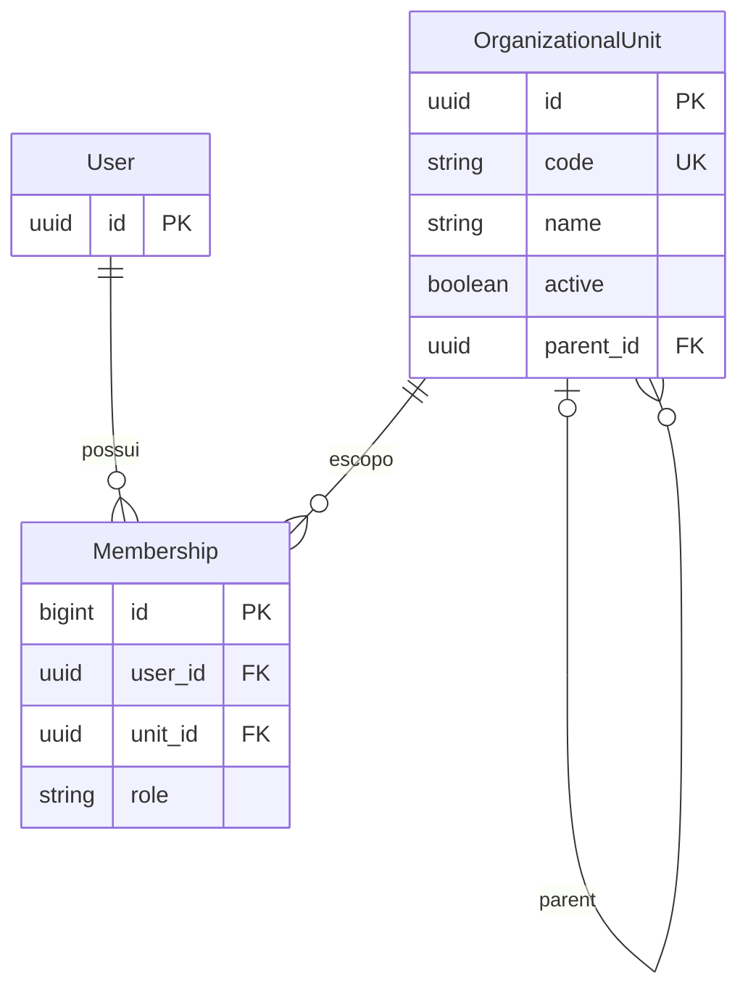
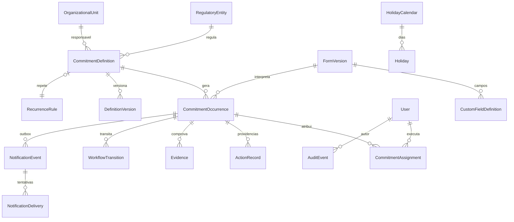
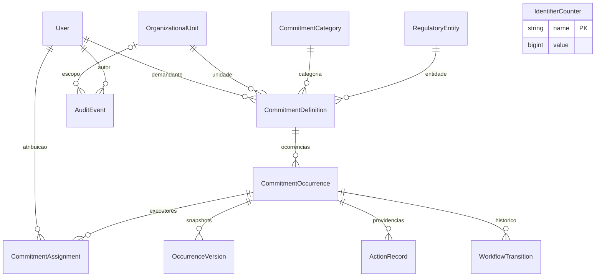
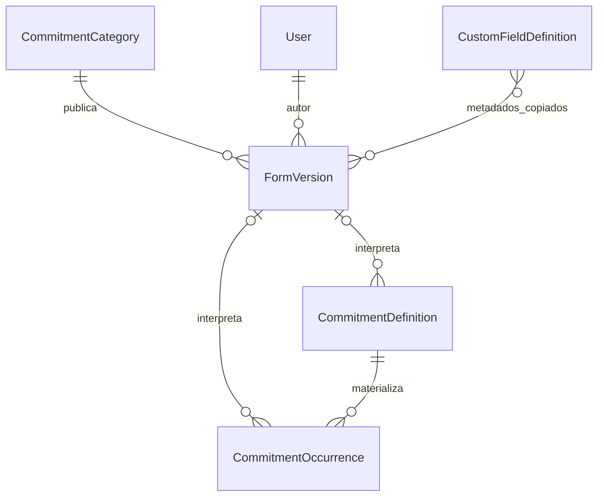

# Modelo de dados
## Implementado

`Membership(user, unit, role)` é único: permite acumular papéis. FK de unidade usa PROTECT. Unidade não pode ser seu próprio pai. A manutenção da árvore completa e detecção de ciclos indiretos serão aplicadas no serviço administrativo antes de expor escrita. UUID de usuário independe do username. Sessões e tentativas Axes usam tabelas próprias das dependências.

## Proposta de expansão (recorrência/campos/evidências/notificações ainda não implementados)

Campos essenciais serão relacionais; JSONB somente para valores dinâmicos e snapshots versionados. Unicidade por definição/chave de ocorrência e por evento/destinatário. Identificadores REG serão sequência transacional separada do UUID; mudanças não reescreverão histórico.

## Relações implementadas na Fase 2

Todas as chaves de domínio são UUID, exceto contador e associação interna. Unicidade: identificador definição/ocorrência; definição+número; ocorrência+executor; ocorrência+revisão de snapshot. Estados válidos e ordinal positivo com constraints. FKs de história usam PROTECT; sem exclusão por API. Snapshot JSON preserva conteúdo e responsáveis, sem substituir relações centrais. Auditoria guarda tipo/id, ator, unidade, timestamps, motivo e antes/depois. Triggers de proteção via migration audit/0002.

## Fase 3
SavedCalendarFilter: UUID, owner FK User (CASCADE), name(80), filters JSON e created_at. Constraint unique(owner,name). JSON contém somente preferências de consulta validadas, sem substituir modelagem do compromisso. API só consulta/cria/remove favoritos do proprietário autenticado.

## Recorrência (Fase 4)
`RecurrenceVersion` pertence à definição, guarda regra/feriados/modelo imutáveis e vigência. Ocorrência aponta para a versão geradora e conserva sua periodicidade/data nominal. Unicidade por definição/data nominal e por definição/ordinal. `Holiday` tem data única, tipo nacional/institucional e estado ativo; mudanças são auditadas, sem exclusão pela API.

## Notificações (Fase 5)
`NotificationEvent`: chave única, ocorrência, tipo, autor e snapshot append-only. `NotificationDelivery`: outbox por evento/destinatário, estado, lease, contador, limite do ciclo, agenda de retry, aceitação e endereço efetivamente usado. `NotificationAttempt`: histórico append-only de início/resultado/reprocessamento, motivo e código sanitizado. `NotificationPolicy`: alvo exclusivo categoria ou definição, intervalos/base/calendário, estado e revisão; mudanças preservadas na auditoria. `NotificationJob`: checkpoint operacional do despachante/verificador.

## Fase 6 — Formulários e valores adicionais
CustomFieldDefinition: UUID, key único/estável, kind estável, name/description, required/default/rules/options/order/active/revision. FormVersion: UUID, category FK, revision única por categoria, name, fields com metadados copiados, actor FK, reason e created_at; append-only. CommitmentDefinition e CommitmentOccurrence: form_version FK PROTECT nullable e custom_values JSONB. Legado permanece com versão null/valores {}. OccurrenceVersion e RecurrenceVersion preservam vínculo e valores em snapshots/templates.

A relação do catálogo com FormVersion é uma cópia de metadados, não uma FK que atualize publicações existentes.

## Fase 7
ReportFavorite: UUID, owner FK PROTECT, name/filters/created_at, unicidade owner+name. Favoritos não guardam autorização. Relatórios são projeções das ocorrências/workflow existentes, sem cópias de resultados permanentes; exportações geram AuditEvent com filtros, quantidade e SHA-256.
